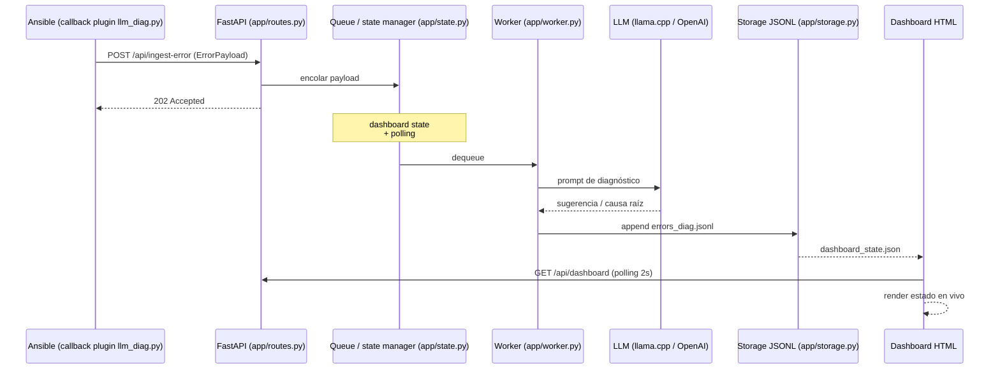

# Ansible LLM Error Monitor v2

Servicio de ingesta de errores de Ansible en tiempo real con diagnóstico automático vía LLM (llama.cpp local o proveedor compatible con OpenAI): FastAPI modular, cola de trabajo en background y dashboard en vivo.

[](https://github.com/bi0punk/ansible-llm-error-monitor/actions/workflows/ci.yml)
[](https://www.python.org/)
[](LICENSE)

## Contenido

- [Características](#características)
- [Arquitectura](#arquitectura)
- [Stack](#stack)
- [Estructura del repositorio](#estructura-del-repositorio)
- [Instalación](#instalación)
- [Uso](#uso)
- [Configuración](#configuración)
- [Tests / CI](#tests--ci)
- [Roadmap](#roadmap)
- [Licencia](#licencia)

## Características

- Ingesta de errores Ansible por HTTP (`POST /api/ingest-error`) desde un callback plugin.
- Diagnóstico automático con provider agnóstico: llama.cpp (local) u OpenAI-compatible.
- Worker en background con cola thread-safe que desencola, diagnostica y persiste.
- Dashboard HTML en vivo con estado consultado por polling (2 s).
- Persistencia sin DB: JSONL (raw + diag) y JSON state.
- Configuración centralizada por variables de entorno; salud del backend y del LLM en `/health`.

## Arquitectura



## Stack

- Python 3.12+
- FastAPI + Uvicorn
- Pydantic v2 (modelos)
- requests (llamadas LLM por HTTP)
- LLM providers: llama.cpp (local) u OpenAI-compatible
- Persistencia: JSONL + JSON state (sin DB)
- Calidad: ruff (lint), pytest

## Estructura del repositorio

```
ansible-llm-error-monitor/
├── main.py              # Entrypoint (uvicorn)
├── requirements.txt
├── pyproject.toml
├── app/
│   ├── __init__.py
│   ├── config.py        # Configuración por variables de entorno
│   ├── models.py        # Pydantic (ErrorPayload, DiagRecord)
│   ├── storage.py       # JSONL append + JSON state R/W
│   ├── llm.py           # Prompts + llamada provider-agnostic
│   ├── state.py         # Manager de estado + cola (thread-safe)
│   ├── worker.py        # Daemon background: dequeue → diagnose → persist
│   ├── routes.py        # FastAPI app + endpoints HTTP
│   └── dashboard.py     # Dashboard HTML (string única)
├── tests/test_smoke.py
├── ansible_flow_example/
│   ├── callback_plugins/llm_diag.py   # Callback que POSTea errores
│   ├── playbooks/site.yml
│   ├── roles/demo/
│   ├── scripts/ (run_fail_assert.sh, run_fail_command.sh, run_ok.sh)
│   └── requirements.txt
└── .github/workflows/ci.yml
```

## Instalación

```bash
pip install -r requirements.txt
uvicorn main:app --reload
# Abrir http://localhost:8000
```

## Uso

Endpoints:

| Método | Ruta | Descripción |
|---|---|---|
| `GET` | `/` | Dashboard en vivo |
| `GET` | `/health` | Chequeo de backend + conectividad LLM |
| `POST` | `/api/ingest-error` | Recibe un payload de error de Ansible |
| `GET` | `/api/dashboard` | Estado actual (polling por la UI cada 2 s) |
| `GET` | `/api/history` | Últimos N errores diagnosticados (`?limit=50`) |

Enviar un error de prueba:

```bash
curl -X POST http://localhost:8000/api/ingest-error \
  -H "Content-Type: application/json" \
  -d '{
    "event_type": "runner_on_failed",
    "host": "web-prod-01",
    "task": "Install nginx package",
    "action": "ansible.builtin.apt",
    "msg": "No package matching \"nginx\" found",
    "rc": 1,
    "failed": true,
    "fingerprint": "abc123"
  }'
```

Flujo Ansible de demostración: `ansible_flow_example/` contiene el callback plugin `llm_diag.py`, inventario, group_vars, roles demo y scripts para simular fallos (`run_fail_assert.sh`, `run_fail_command.sh`, `run_ok.sh`). Ver `ansible_flow_example/README.md` para detalles.

Archivos de datos en `./data/`:

- `errors_raw.jsonl` — payloads entrantes crudos
- `errors_diag.jsonl` — diagnósticos LLM completados
- `dashboard_state.json` — estado del dashboard (sobrescrito en cada update)

## Configuración

| Variable | Default | Descripción |
|---|---|---|
| `LLM_PROVIDER` | `llama_cpp` | `llama_cpp` u `openai` |
| `LLAMA_BASE_URL` | `http://127.0.0.1:8080` | URL del servidor llama.cpp |
| `LLAMA_MODEL_NAME` | `Qwen2.5-7B-Instruct-Q4_K_M.gguf` | Nombre del archivo del modelo |
| `OPENAI_BASE_URL` | `https://api.openai.com/v1` | Base URL compatible OpenAI |
| `OPENAI_API_KEY` | *(vacío)* | API key para el provider OpenAI |
| `OPENAI_MODEL` | `gpt-4.1-mini` | Identificador del modelo |
| `LLM_TIMEOUT` | `180` | Segundos de timeout de la llamada LLM |
| `DATA_DIR` | `./data` | Directorio para JSONL/JSON |

## Tests / CI

```bash
DATA_DIR=/tmp/ansible-monitor-data LLM_PROVIDER=none pytest -q
```

Smoke tests (`tests/test_smoke.py`): health, ingest-error (POST), dashboard e history. Usan `LLM_PROVIDER=none` (sin LLM real) y `DATA_DIR` efímero.

CI: GitHub Actions (`.github/workflows/ci.yml`) sobre Python 3.12 — **lint** (`ruff check .`) y **test** (`pytest -q` con `DATA_DIR=/tmp/...` y `LLM_PROVIDER=none`).

## Roadmap

- [x] Ingesta HTTP + diagnóstico LLM (provider agnóstico)
- [x] Dashboard en vivo con polling
- [x] Persistencia JSONL + estado
- [ ] Persistencia en base de datos real (PostgreSQL)
- [ ] Autenticación para la ingesta de errores
- [ ] Agrupación de errores por fingerprint

## Licencia

MIT — ver [LICENSE](LICENSE).